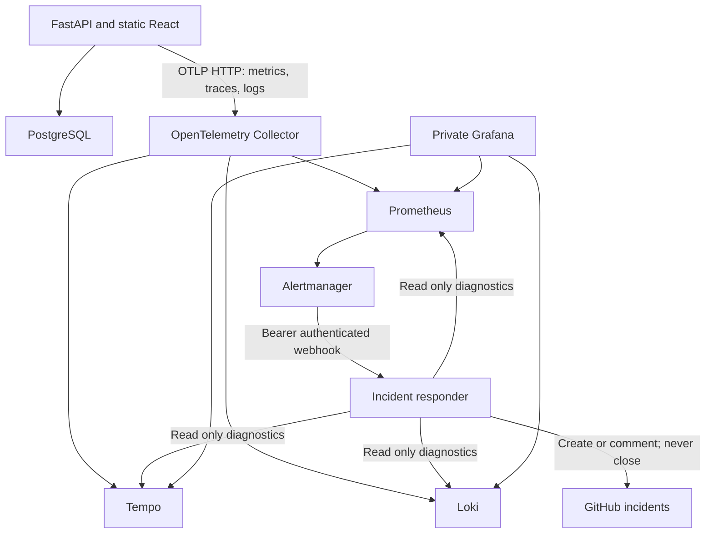

# SignalDesk deployment and incident operations

Tracked by Issues #49–#65, created before implementation on 2026-11-16.
Existing React/FastAPI features, PostgreSQL schema and SQLite migration history
are preserved. No new public authentication endpoint exists.

## Architecture



Collector, Prometheus, Alertmanager, Loki, Tempo, blackbox exporter and PostgreSQL
exporter have no host ports. Grafana listens only on loopback and requires a
password. Never publish these internal services directly. Use an authenticated
SSH tunnel or HTTPS access proxy for remote Grafana. The responder has an egress
network for GitHub; it has no Docker socket, shell tools, cloud credentials or
application mutation credentials. Network policy is service isolation, not a
full outbound firewall; enforce destination restrictions at the host for an
untrusted multi-tenant environment.

## Isolated Compose environments

Copy `.env.development.example` to `.env.development` and the production example
to `.env.production`. Fill each blank secret with a distinct random URL-safe
value (for example output of `openssl rand -hex 32`). Never commit real `.env`
files. Configure separate OAuth clients/callbacks and approved account lists.
Production requires an immutable GHCR image digest and actual HTTPS ingress.
The monitoring overlay requires modern Docker Compose with environment-backed
secrets. Render does **not** execute this Compose stack; its image-backed services
and managed PostgreSQL are a separate deployment target.

```sh
# Local build for development; only one Dockerfile is used for both services.
docker build -t signaldesk-local .
.venv/bin/python -m scripts.compose_environment development config
.venv/bin/python -m scripts.compose_environment development up
.venv/bin/python -m scripts.compose_environment development ps
.venv/bin/python -m scripts.compose_environment development logs
```

Launcher uses `signaldesk-development` / `signaldesk-production` project names,
separate database roles/names, project-scoped volumes and distinct application
ports 8001/8000 and Grafana ports 3001/3000. It rejects wrong environment markers,
shared configured secrets, mismatched ports, mutable production tags and HTTP
production URLs. Do not bypass it by reusing a shared Compose project name.
`stop` retains data; no launcher action deletes volumes. An external PostgreSQL
installation must also use separate databases and non-overlapping credentials.
The Compose exporters use the existing database role on a private network;
production operators should provision a separate `pg_monitor` exporter role
before broader operational access. No DB ports are published.

The overlay resource limits total roughly 3.2 GiB plus Docker/OS overhead. It is
not a claim that a small free instance can host it. Retention is 24h for logs and
traces, 7d/1GB for Prometheus. Volumes also require disk monitoring; retention is
not an absolute filesystem quota. No telemetry service is provisioned in cloud
by running tests.

## Instrumentation

`backend/telemetry.py` creates per-application SDK providers and flushes them on
shutdown. Set `APP_ENV` (`local`, `test`, `development`, `production`) and optional
`OTEL_EXPORTER_OTLP_ENDPOINT`, e.g. internal `http://collector:4318`. With no endpoint
no telemetry leaves the process. Use `OTEL_TRACES_SAMPLER=parentbased_traceidratio`
and `OTEL_TRACES_SAMPLER_ARG=0.1` to reduce trace volume; request/business metrics
remain unsampled. For correlation smoke tests use `always_on` or an explicitly
sampled W3C parent. The collector has memory limiting and bounded batches.

| Signal | Meaning |
|---|---|
| `signaldesk_http_requests_total` | Completed HTTP attempts by route template, method, status |
| `signaldesk_http_duration_seconds` | Request latency histogram |
| `signaldesk_process_memory_bytes` | Current Linux process RSS; peak RSS fallback on other OS |
| `signaldesk_process_cpu_seconds_total` | Process CPU time |
| `signaldesk_client_create_total`, `signaldesk_client_update_total` | Client mutation attempts by success/failure |
| `signaldesk_campaign_create_total`, `signaldesk_campaign_update_total` | Campaign mutation attempts by outcome |
| `signaldesk_daily_metric_save_total` | Daily metric create/update attempts by outcome |
| `signaldesk_report_generate_total` | Report generation attempts by outcome |
| `signaldesk_user_create_total`, `signaldesk_user_update_total` | Access account mutation attempts by outcome |
| `signaldesk_assignment_update_total` | Assignment update attempts by outcome |
| `signaldesk_business_failures_total` | Failed business requests by fixed operation name |
| `signaldesk_permission_denials_total` | HTTP 403 responses by fixed route |

Business counters are emitted at request completion after actual route handling;
validation/auth failures count as failed attempts, not completed DB mutations.
No user IDs, email addresses, client/campaign IDs, financial amounts, bodies,
cookies, raw URLs or SQL values are metric/span attributes. SQL child spans
contain only dialect and an allowlisted SQL verb. HTTP errors set span error
status without exporting exception text. Uvicorn access logs are disabled in the
production start script; traceback text is redacted by the application filter.
JSON request logs contain only event, template, method, status, duration and
trace/span IDs. OTLP logs carry the same JSON body for Grafana correlation.

Grafana provisioning loads Prometheus, Loki and Tempo data sources and the
`SignalDesk operations and business` dashboard. Panels use actual application
metrics, PostgreSQL exporter sessions/transactions, health probes, CPU/memory and
business operation metrics. Empty panels mean no matching observations yet;
there are no random or fabricated values. Loki log links and Tempo traces-to-logs
use the exported trace ID.

## Alerts and controlled verification

Six rules: >5% HTTP 5xx for 5m, p95 >1s for 5m, failed/missing application probe
for 2m, failed/missing PostgreSQL exporter for 2m, process RSS >80% of its 512MiB
limit for 5m, and >5 business operation failures in 10m sustained for 2m.
Prometheus environment-specific configs add the environment label to alerts.
Alertmanager groups by environment/name, waits 30s, repeats hourly, sends recovery
and inhibits application-unavailable while database-unavailable is firing.

```sh
# Synthetic time-series tests; no production interruption.
docker run --rm -v "$PWD/observability:/work:ro" -w /work \
  --entrypoint promtool prom/prometheus:v3.5.0 test rules alert-tests.yaml
# After stack startup, run from its application container/private network:
docker compose --env-file .env.development -p signaldesk-development \
  -f compose.yaml -f compose.observability.yaml exec -T app \
  python /app/observability_smoke.py
```

`alert-tests.yaml` checks firing and recovery for all six rules against controlled
series. `observability_smoke.py` checks readiness, real exported app and database
metrics, a known correlated trace and stored logs. Unit tests verify webhook auth,
limits, deduplication, recovery and failure retry without interrupting production.
Native readiness endpoints exist even where an image has no shell/wget; the smoke
check queries those endpoints. Do not mistake Collector config validation for
service readiness.

## Incident responder and human decisions

`ALERT_WEBHOOK_TOKEN` must be at least 32 characters and is passed to Alertmanager
as a file secret. Payloads are limited to 32KiB and ten alerts. Only six known
alert names and three known environments are accepted. Annotation URLs, commands,
queries and provided fingerprints are ignored. All diagnostic URLs and queries
are fixed; HTTP redirects are disabled, requests time out, diagnostic responses
are capped at 64KiB. Raw logs are counted but never forwarded to GitHub or a model.

SQLite in the responder is an operational deduplication ledger, not the
application database (which remains PostgreSQL). A single worker serializes
ledger and delivery transitions, persisted in `incident-data`. The key is
`environment:alertname`, hashed locally. Repeats within an hour are acknowledged
without another notification. Recovery comments on the same issue and never
closes it. GitHub delivery failures return 503 so Alertmanager retries. Before
creating an issue, the responder searches the first 100 incident-labelled issues
for its key to recover from interrupted writes; larger repositories require
pagination before claiming global deduplication. Configure a fine-grained
`INCIDENT_GITHUB_TOKEN` restricted to this private repository's issues write and
deployments read; it must not grant code/deployment mutation. Without this token,
reports persist locally with `delivery=local_only`; notifications are not claimed.
GitHub Issues is the implemented notification channel; no Slack/email delivery
is configured or claimed.

LLM calls require **separate operator approval**: `INCIDENT_LLM_APPROVED=true`,
`OPENAI_API_KEY`, `INCIDENT_LLM_MODEL` and `INCIDENT_LLM_DAILY_CALLS` (default5,
hard maximum20) in a private operator overlay. The supplied Compose keeps it
false. Each attempt reserves durable budget first (including failures), accepts
at most 4000 input characters and requests at most500 completion tokens. Set a
provider project spending limit too; local call/token caps are not a guarantee
of a zero provider bill. No key/model/credit approval is currently configured.
Only numeric summaries and validated commit hashes are sent. Model text is
untrusted, returned for local human review, and never executed or automatically
published. GitHub reports separate observations from unconfirmed hypotheses.

Every report states that production remediation requires human review. An
operator chooses and records an action on the incident, verifies backup/schema
compatibility, and invokes the separately protected production workflow if a
rollback is necessary. There is intentionally no webhook parameter that grants
action authority, no automatic migration/rollback, and no issue auto-closure.

## CI and immutable deployment promotion

`ci.yml` runs regression, frontend build, PostgreSQL integration, real Compose,
17 Playwright journeys, restart persistence, controlled alert tests, Collector
validation and actual observability smoke checks. Reports/logs are uploaded on
failure. Only successful `develop` pushes publish the saved tested image to GHCR,
deploy an **image-backed** Render development service by digest and create the
`development-verified` receipt after HTTPS health/frontend checks. CI never
rebuilds an application image as part of production promotion.

Create GitHub environments `development` and `production`. Give each different
`RENDER_SERVICE_ID`, API credential, database, OAuth secrets and `LIVE_URL`.
Configure production required reviewers and branch restriction `main` in GitHub
settings where the private-repository plan permits it. No paid plan upgrade is
authorized; if the plan lacks environment approval rules, keep the workflow's
manual trigger plus per-commit migration gate and record the limitation.
Do not put production secrets at repository level. Disable Render native
autodeploy on both services so GitHub controls the gate. Private GHCR images
require a narrowly scoped Render registry credential configured by the account
owner; do not publish the private project to avoid authentication.

For production run `production.yml` manually **on main**, supplying a successful
development CI run ID. The guard checks the trusted workflow ID, successful push
on develop, matching commit/run ID, smoke receipt and repository-bound SHA256
image digest. It does not accept tags. In the production environment set
`MIGRATION_APPROVAL` to that exact source SHA only after verifying a restorable
backup and compatible Alembic changes. Approval is intentionally per commit.
The existing startup script runs Alembic before serving traffic. This extension
adds no application schema migration. Deployment history is recorded by GitHub
environment/job and workflow summary; a failed Render deploy or HTTPS/DB smoke
check fails the workflow.

### Backup and rollback

For Compose use `python -m scripts.backup_database production --directory /PRIVATE/BACKUPS`.
It writes a new mode600 custom-format pg_dump and checksum manifest. Test restore
into a separate disposable database, never the live DB. Managed Render databases
need an owner-created export/snapshot and test restore under that provider's
available plan. A migration gate is human attestation, not automatic proof of a
restorable backup. For backward-compatible schema rollback, manually promote a
previous successful development receipt/digest. Never automatically downgrade
Alembic or restore a dump over production. Incompatible schema rollback needs an
approved maintenance and data recovery plan. Receipts expire after30days; retain
approved release manifests/digests in a durable release record before expiry.

## Exact deployment blockers and costs

No development/production Render service IDs, API credentials, application OAuth
credentials, verified URLs, registry credentials or approved model budget are
available to this implementation. No AWS credentials or account credit/free-plan
eligibility has been verified. Existing `infra/cloudformation.yaml` is retained;
no claim is made that its small host can run the full monitoring stack. AWS and
Render login in a browser do not grant deployment credentials or confirm credits.
No resources, paid plans or billing settings are provisioned by this extension.
The prepared CI/deployment workflows are not proof of a successful hosted deploy.

Use open-source local components until provider pricing, credits, quotas and
account plan are checked with the owner. Request specific approval before any
spending or paid account upgrade. The full-stack observability rollout and
external delivery Issues remain open until actual verification is recorded.

## Troubleshooting

- `Invalid alert payload`: verify Prometheus external environment label/config;
  arbitrary annotations do not affect routing.
- Webhook401: ensure the same strong token in responder environment and
  Alertmanager file secret. Never paste it into an Issue.
- Empty graphs: generate actual requests, wait for export/scrape, inspect
  Collector errors and private service readiness. Check sampler for traces.
- No GitHub notification: inspect local ledger/delivery field and token scopes;
  503 means upstream delivery failed and must retry.
- Production gate failure: use a genuinely successful develop deployment run,
  exact reviewed SHA and environment-scoped configuration. Do not weaken guards.
- PostgreSQL health failure: inspect DB container/private connectivity and
  migrations; never delete a volume as a generic repair step.

Primary references used: [OpenTelemetry Python exporters](https://opentelemetry.io/docs/languages/python/exporters/),
[Loki native OTLP](https://grafana.com/docs/loki/latest/send-data/otel/),
[Alertmanager configuration](https://prometheus.io/docs/alerting/latest/configuration/),
[Render prebuilt images](https://render.com/docs/deploying-an-image).
